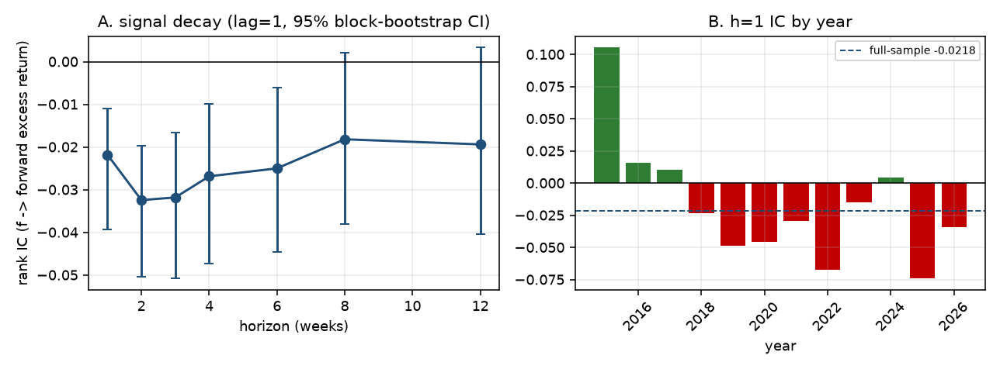
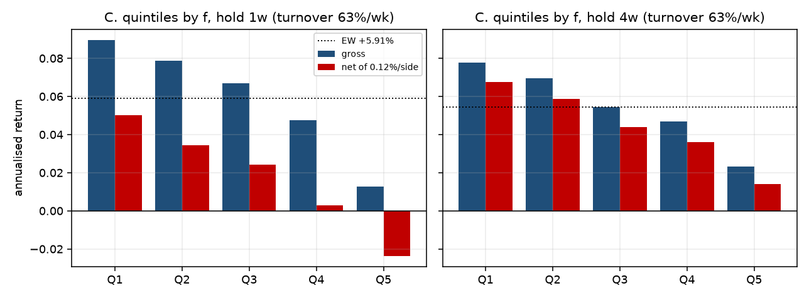

# E2：ETF 份额净申赎（资金流）是否可交易

分支 `research/e2`（基线 `main@6170838`，main 未改动），数据截至 **2026-11-13 收盘**。
所有数字由 `quant2/e2/*.py` 实跑产出，原始结果：
`out/e2/E2_stats_lag{0,1,2}.json`、`E2_extra.json`、`E2_extra2.json`、`E2_checks.json`、
`E2_portfolio.json`、`f_profile_by_etf.csv`、`dim_check.csv`、`jsl_check.csv`、`e2_*.png`。

## 结论（先看这里）

| 层级 | 判定 | 依据 |
|---|---|---|
| **数据可得性** | **GO** | 两个交易所官方接口都有**按日期取历史**的每日份额：上交所 2882 个交易日（2015-01-05 起）、深交所 2426 个交易日（2016-11-17 起）；**794 只 ETF** 进入面板，**344 只 ≥200 周**（中位 174 周）。量纲校验对官方季度报表 136 个观测点，份额比率 0.9993、净资产比率 1.0001，无一超 3% |
| **机制是否存在** | **GO（拥挤度反转，方向确定）** | f 对 1/2/4 周超额收益 rank IC **−0.022 / −0.032 / −0.027**（t −3.1 / −4.1 / −3.0，n≈580），PIT lag 0/1/2 全为负；五分位单调性 **−1.00**（Q1 最被赎回 +8.97% vs Q5 最被申购 +1.28%）；但**只存在于 2020 年以后**（2015–2019 IC +0.002，t 0.2），且 2015 年为**反向**（+0.105） |
| **增量（控制 60 日动量后）** | **边际：h1 不达标，h2 达标** | 残差 IC h1 **0.0137**（t −2.01，门槛 0.02 → **不达标**）、h2 **0.0237**（t −3.08，**达标**）、h4 0.0182（边际）；正交性 mean\|ρ\|=0.147、\|ρ\|>0.5 仅 1.1%，不是动量的噪声版 |
| **独立策略** | **NO-GO** | 五分位 Q1 毛 +8.97%/年，周换手 63% → 成本 3.95%/年；**净 +5.02% < EW 毛 5.91%**。裸做 top3 集中组合换手 110%/周、成本 6.9%/年，净收益 ≈ 0 |
| **可落地用法** | 排序惩罚项 + 极端申购风控 | 在动量组合里剔除 f 最高 20%：**+0.82pp/年（t 1.38，不显著）**；流动性前 30% 子样本 **+2.5pp/年（t 1.93）**；评分合成 top10% **+4.8pp/年（t 2.18）** 但只有 22 只、换手 62%/周 |
| **能否进组合** | **可以，但只能当惩罚项，估 +1~2pp/年** | 边际成本≈0（本来就每周换仓），不改变主策略结构 |

一句话：**净申购 → 未来跑输（拥挤度反转）是真的、且与动量正交；但毛收益（~8pp/年）刚好等于它自己的换手成本（~4-7pp/年），独立做不了，只能当排序惩罚项和“极端申购不加仓”的风控。**

---

## 1. 数据可得性

### 1.1 试过的源（8 个）

| # | 源 | 结果 |
|---|---|---|
| 1 | akshare `fund_etf_scale_sse(date=YYYYMMDD)` → 上交所 `query.sse.com.cn` `sqlId=COMMON_SSE_ZQPZ_ETFZL_XXPL_ETFGM_SEARCH_L&STAT_DATE=` | **成功**，可指定历史日期，返回当日全市场沪市 ETF 份额（份） |
| 2 | akshare `fund_scale_daily_szse(ETF)` → 深交所 `szse.cn/api/report/ShowReport` `CATALOGID=scsj_fund_jjgm` | **成功**，按 ≤6 个月区间返回逐日份额；2016-11 起有数据，2017 年前返回空 |
| 3 | akshare `fund_etf_scale_szse()` | 只给当日快照（`CATALOGID=1000_lf`），无历史 → 弃用 |
| 4 | 东财 `push2/api/qt/stock/get`（f84=总份额, f117=规模） | 当日快照可用，但**复现了 ConnectionError**（`RemoteDisconnected`，4 次重试全失败），且无历史 → 只作为量纲旁证，弃用 |
| 5 | 天天基金 f10 `FundArchivesDatas.aspx?type=gmbd` | **成功**，季度官方「期末总份额/期末净资产」→ 用作**量纲校验基准**（136 个观测点） |
| 6 | 集思录 `jisilu.cn/data/etf/etf_list` | 成功，但只返回前 20 行（分页参数无效）；用这 20 只用做**第二源抽查** |
| 7 | 东财 `fund_etf_spot_em` / `fund_etf_hist_em` 等 `fund_etf_*` 全系列（25 个函数） | 均为**行情/净值**类，不含份额；`fund_etf_fund_daily_em`、`fund_etf_fund_info_em`、`fund_etf_hist_sina` 都不含份额 → 弃用 |
| 8 | 新浪基金 `CaihuiFundInfoService.getNav` | 只有净值与季度规模，无日频份额 → 弃用 |

价格用腾讯 `newfqkline`（**前复权**，因为 E2 要用总收益；E1 用不复权是因为要比净值），
交易日历 `data/meta/index_calendar.json`（5600 个真实交易日），份额/价格日期全部校验在日历内，
周频网格取**每个 ISO 周最后一个交易日**，无假 bar。

### 1.2 覆盖与深度

| 项目 | 数值 |
|---|---|
| 上交所缓存 | 2882 个交易日 × 最多 1006 只（2015-01-05 → 2026-11-13），0 个日期失败 |
| 深交所缓存 | 2426 个交易日 × 最多 817 只（2016-11-17 → 2026-11-13），121 个月度窗口全成功 |
| 代码并集 | 1823 只 |
| 进入分析面板（有份额+价格+过流动性门槛） | **794 只** |
| **≥200 周**（≈4 年） | **344 只** → 门槛（≥100 只）**通过 3.4 倍** |
| ≥250 周 | 259 只 |
| 周频样本 | **607 周**（2015-01-09 → 2026-11-13），IC 有效周数 578–581 |
| 每周截面只数 | 中位 163 只/周（2020 年中位 118、2026 年中位 **506**） |

门槛：规模 ≥2 亿、60 日中位成交额 ≥500 万、且已连续 20 周满足（全部用**滚动过去**判定，无未来信息；
ETF 退市后仍保留在面板里，避免幸存者偏差）。

### 1.3 量纲校验（3 只：510300 / 159928 / 513100）

基准 = 天天基金 f10 官方季度表「期末总份额（亿份）」「期末净资产（亿元）」，在报告期末对应的
最后一个交易日比对，共 **136 个观测点（2015Q1–2026Q3）**：

| 检验 | 均值 | 中位 | 最小 | 最大 | 超 3% 的观测 |
|---|---|---|---|---|---|
| 我们份额 / 官方期末总份额 | **0.9993** | 1.0000 | 0.9908 | 1.0003 | **0** |
| (我们份额 × 单位净值) / 官方期末净资产 | **1.0001** | 1.0000 | 0.9978 | 1.0051 | **0** |

偏差全部来自官方表把份额四舍五入到 0.01 亿份（如 513100 我们 2.6362 亿 vs 官方 2.64 亿）。
单位是**份**，不是万份/千份；不存在错列、错量纲。

第二源：集思录 2026-11-13 快照 20 只，`amount`（万份）×1e4 与我们**逐只比率 1.0000**。

### 1.4 两个必须记录的处理

1. **份额拆分/折算**：与 E1 同源问题（513100 五拆一、513600 反向折算等）。检测规则
   `|Δln份额|>0.20 且 |Δln份额+Δln净值|<0.08`（折算时份额与净值反向等幅变动、规模不变），
   共修 **105 个事件 / 98 只**，修完后 f 的 p0.1 分位仅 −26.7%，无 ±数倍的假申赎。
2. **2026-01 的“汇金式”巨额赎回是真的**：510300 规模 2025-12 的 4223 亿 → 2026-01 的 2295 亿，
   510050 1759→803 亿，159919 1971→1021 亿，同期 588000（科创50）、512880（证券）不动。
   路径是 4 周内**逐日平滑下降**（不是单日跳变），净值同期未跳变 → 判定为真实的大规模赎回潮，
   不是数据错误，保留在样本里；它也是“份额数据确实抓到了真实一级市场行为”的旁证。

### 1.5 GO / NO-GO

**GO。** 判据（≥100 只、每只 ≥200 周、量纲通过）三项全过，且样本深度 11.8 年、344 只 ≥200 周。

---

## 2. 若 NO-GO（本节不适用，记录备选）

数据是 GO 的，本节不适用。但**备用代理**已顺手确认可用（备将来降级）：
场内成交额/换手率（腾讯日线自带 amount，已缓存 823 只）、集思录当日份额快照（无历史）、
天天基金季度份额（14 个季度，频率太低）。若交易所接口哪天停了，**季度份额无法支撑周频研究**，
届时应直接 NO-GO 而不是拿换手率冒充申赎率。

---

## 3. 申赎率的统计画像

f = 本周份额 / 上周份额 − 1（正=净申购）。全样本 132,991 个 ETF-周观测：

| 分位 | p1 | p5 | 中位 | p95 | p99 |
|---|---|---|---|---|---|
| f | −12.0% | −5.7% | 0.0% | +7.1% | +19.3% |

极端频率：P(f>+10%)=**3.04%**、P(f>+30%)=**0.41%**、P(f<−10%)=**1.59%**、P(f<−30%)=**0.08%**。

按类别（每只 ETF 的时间序列统计后再按类平均）：

| 类别 | 只数 | f 均值/周 | f 标准差 | p5 | p95 | P(f>+5%) | P(f<−5%) | P(f>+20%) | 规模中位(亿) |
|---|---|---|---|---|---|---|---|---|---|
| 宽基 | 109 | +0.21% | 4.89% | −6.0% | +7.0% | 7.9% | 7.7% | 1.05% | 5.3 |
| 行业 | 288 | +0.24% | 4.54% | −5.6% | +6.8% | 7.8% | 6.7% | 1.03% | 4.9 |
| 跨境 | 65 | **+0.70%** | 4.46% | −4.5% | +7.5% | 8.9% | 4.4% | 0.92% | 6.7 |
| 债券 | 17 | +1.26% | 6.12% | −4.9% | +10.0% | 10.7% | 5.9% | 1.52% | 11.8 |
| 商品 | 12 | +1.12% | 7.27% | −6.9% | +12.0% | 15.1% | 8.4% | 2.16% | 5.0 |

- 跨境 ETF 是**唯一长期净申购**的大类（+0.69%/周），符合 QDII 额度受限、只能靠场内申购扩张的现实。
- 债券/商品的极端申赎频率最高（P(f>+5%) 10.7%/14.9%），但样本只数少。
- f 自相关：1 周 0.267、2 周 0.169、4 周 0.110 → 流量本身**半衰期 ~2 周**。
- f 与**过去**收益负相关：corr(f_t, 上周收益) = **−0.139（t −19.0）**、corr(f_t, 60 日动量) = −0.057（t −6.8）
  → 一周尺度上是“涨了就被赎回”（获利了结），这也解释了为什么它不是动量的翻版。

---

## 4. 横截面 IC + 五分位 + 单调性

基准口径：lag=1（用 T−1 的份额，T 日收盘建仓，完全 PIT 可行），未来收益为 close(t)→close(t+h) 减当周截面均值。

### 4.1 rank IC

| 持有期 | IC | t（NW） | n | 95% CI（block bootstrap） | IC>0 的周占比 |
|---|---|---|---|---|---|
| 1 周 | **−0.0218** | −3.08 | 581 | [−0.0393, −0.0110] | 43.4% |
| 2 周 | **−0.0324** | −4.13 | 580 | [−0.0504, −0.0197] | 41.6% |
| 4 周 | **−0.0269** | −2.97 | 578 | [−0.0473, −0.0099] | 42.9% |

衰减：IC 在 **2 周最强**，6 周 −0.025（t −2.72），8 周 −0.018（t −1.96）、12 周 −0.019（t −1.73）
→ **半衰期约 4–6 周**（比 E1 溢价的 1 周长得多，这对成本是好事）。

### 4.2 五分位（单边成本 0.12%，按名称级换手逐周计）

**持有 1 周**（n=581 周）：

| | Q1 最被赎回 | Q2 | Q3 | Q4 | Q5 最被申购 | EW |
|---|---|---|---|---|---|---|
| 毛年化 | **+8.97%** | +7.89% | +6.70% | +4.76% | **+1.28%** | +5.91% |
| 周换手(单边) | 63% | 71% | 68% | 71% | 58% | — |
| 成本/年 | 3.95% | 4.44% | 4.26% | 4.45% | 3.63% | — |
| **净年化** | **+5.02%** | +3.46% | +2.44% | +0.31% | **−2.36%** | +5.91% |

**持有 4 周**（n=578 周）：

| | Q1 | Q2 | Q3 | Q4 | Q5 | EW |
|---|---|---|---|---|---|---|
| 毛年化 | +7.77% | +6.97% | +5.45% | +4.71% | +2.33% | +5.46% |
| 周换手(单边) | 63% | 71% | 68% | 71% | 58% | — |
| 成本/年 | 0.99% | 1.11% | 1.07% | 1.11% | 0.91% | — |
| **净年化** | **+6.78%** | +5.87% | +4.38% | +3.60% | +1.42% | +5.46% |

- 单调性（五分位序号 vs 年化）**h1 = −1.00、h2 = −1.00、h4 = −1.00**（完全单调，方向为“申购越多越差”）。
- 多空价差（不可做空，只用来衡量信号强度）：周频 L/S 序列复利 **+12.7%/年（t 4.73，胜率 60.5%）**；
  十分位 Q1−Q10 **+13.1%/年（t 3.67，CI [+5.4%, +18.1%]）**。
- **但 Q1 净收益 5.02% < EW 毛 5.91%**：单腿做多是亏的，因为换手成本 3.95pp 正好吃掉毛 edge。

### 4.3 极值分桶（未来 4 周超额收益）

| f 桶 | <−30% | −30~−10% | −10~−2% | −2~2% | 2~10% | 10~30% | >30% |
|---|---|---|---|---|---|---|---|
| 4 周超额 | −3.20%* | +0.71% | +0.65% | +0.38% | +0.25% | **−0.38%** | +0.94%* |
| 年化 | −34% | +9.6% | +8.8% | +5.1% | +3.3% | **−4.8%** | +13% |
| 有效周数 | 6 | 259 | 524 | 577 | 503 | 324 | 60 |

\* 两端样本太少（<10 只/周），不可信。**可用的信号在 −30%~+30% 区间，且 10~30% 这一档最差。**

---

## 5. 增量检验：控制 60 日动量后还剩多少

### 5.1 正交性

截面 Spearman(f, 60 日动量)：均值 **−0.060**、mean\|ρ\| **0.147**、p90\|ρ\| 0.306、
\|ρ\|>0.5 的周仅 **1.1%** → **远低于 0.5 门槛**，f 不是动量的噪声版。

### 5.2 残差 IC（f 对动量做截面回归取残差）

| 持有期 | 原始 IC | 残差 IC | t | 相对原始 | 门槛 >0.02 |
|---|---|---|---|---|---|
| 1 周 | −0.0218 | **−0.0137** | −2.01 | 保留 63% | **不达标** |
| 2 周 | −0.0324 | **−0.0237** | −3.08 | 保留 73% | **达标** |
| 4 周 | −0.0269 | −0.0182 | −1.99 | 保留 68% | 边际（差 0.002） |

### 5.3 双变量截面回归（标准化，按周聚类）

| 持有期 | b(f) 系数 | t(f) | b(mom) 系数 | t(mom) | 观测数 |
|---|---|---|---|---|---|
| 1 周 | −0.092% | **−5.09** | +0.047% | 0.73 | 117,315 |
| 2 周 | −0.137% | **−5.26** | +0.070% | 0.77 | 116,811 |
| 4 周 | −0.207% | **−5.60** | +0.073% | 0.58 | 115,803 |

→ 控制动量后资金流依然显著为负；而**动量在这个全 ETF 池里本身不显著（t 0.6–0.8）**，
说明 f 提供的不是“动量的另一面”。

### 5.4 双重排序（动量三分位 × f 五分位，未来 4 周超额）

| 动量桶 | Q1(最被赎回) | Q2 | Q3 | Q4 | Q5(最被申购) | Q1−Q5 |
|---|---|---|---|---|---|---|
| 低动量 | +0.83% | +0.58% | +0.53% | +0.63% | +0.40% | **+0.43%** |
| 中动量 | +0.82% | +0.69% | +0.55% | +0.65% | +0.47% | **+0.35%** |
| 高动量 | +0.99% | +0.84% | +0.48% | +0.36% | +0.17% | **+0.82%** |

→ **三个动量桶内部都是“申购越多越差”**，且高动量桶里价差最大（0.82%/4 周 ≈ 10%/年）。
这正是“拥挤度惩罚项”的标准形态。

---

## 6. 稳健性与 PIT 检查

### 6.1 PIT（份额 T 日盘后公布，逐级滞后）

| lag | h1 IC | h2 IC | h4 IC |
|---|---|---|---|
| 0（同日，乐观） | −0.0316 (t −4.45) | −0.0350 (t −4.51) | −0.0308 (t −3.36) |
| **1（基准，保守）** | **−0.0218 (t −3.08)** | **−0.0324 (t −4.13)** | **−0.0269 (t −2.97)** |
| 2（更保守） | −0.0175 (t −2.48) | −0.0319 (t −4.18) | −0.0234 (t −2.64) |

→ 逐级衰减但不翻转；h2 几乎不动。**不是同日同 bar 的假象**，且滞后越保守边际越小（这本身是信号变弱的证据，
但方向稳定）。

### 6.2 分样本（h1 / h2 / h4）

| 样本 | h1 | h2 | h4 |
|---|---|---|---|
| 全样本（2015–2026） | −0.0218 (t −3.1) | −0.0324 (t −4.1) | −0.0269 (t −3.0) |
| 剔除 2015 | −0.0280 (t −4.1) | −0.0374 (t −4.9) | −0.0335 (t −3.9) |
| **2015–2019** | **+0.0021 (t 0.2)** | −0.0122 (t −0.8) | −0.0043 (t −0.3) |
| **2020–2026** | **−0.0375 (t −5.0)** | −0.0457 (t −5.2) | −0.0417 (t −4.3) |
| 剔除 2025–26 | −0.0150 (t −1.9) | −0.0257 (t −2.9) | −0.0199 (t −2.0) |
| 剔除 2026 | −0.0208 (t −2.8) | −0.0311 (t −3.8) | −0.0251 (t −2.7) |

**失效模式（重要）**：效应**只在 2020 年后存在**。2015–2019 六年间 IC 为 0，2015 年甚至是 **+0.105**
（杠杆牛里申购跟着上涨走，是动量不是反转）。合理解释：2019 年前 ETF 池以宽基为主、申赎主体是机构套利，
2020 年后行业/主题 ETF 爆发、散户与游资通过申购涌入。**这条要写进使用前提：只在 ETF 拥挤度成为现象之后才成立。**

### 6.3 分类别（h4 IC）

| 类别 | IC | t | 平均截面只数 |
|---|---|---|---|
| 跨境 | **−0.0610** | −2.80 | 23.8 |
| 债券 | **−0.0729** | −2.82 | 7.7 |
| 商品 | −0.0334 | −1.47 | 7.3 |
| 宽基 | −0.0272 | −2.39 | 56.6 |
| 行业 | −0.0262 | −2.13 | 123.7 |

### 6.4 分规模（h1 IC，按当周规模三分位）

| 规模分组 | IC | t |
|---|---|---|
| 小（后 1/3） | −0.0188 | −1.27 |
| 中 | −0.0128 | −1.26 |
| **大（前 1/3）** | **−0.0251** | **−2.97** |

→ 效应在**大 ETF 上最强且显著**，正好是成本最低、可以真正交易的那一档。

### 6.5 其他稳健性（h1）

| 处理 | IC | 说明 |
|---|---|---|
| 原始 | −0.0218 | — |
| 按周 1%/99% winsorize f | −0.0218 | 不受极值驱动（rank IC 本来就稳健） |
| 剔除上市后 26 周内 | −0.0312 | 更强，排除新基金建仓期 |
| 流量“意外”（f − 8 周均值） | −0.0099 (t −1.5) | **大幅减弱** |
| 流量自身 z 分数（12 周） | −0.0148 (t −2.3) | 减弱 |
| \|f\|（不分方向） | −0.0052 (t −0.9) | 不显著 |

→ **原始 f 最好**；标准化/去趋势都会损失信息。方向性（申购 vs 赎回）才是信号，波动大小不是。

---

## 7. 扣成本后的结论

单边 0.12%，名称级换手逐周计（`Σ|w_t − w_{t−1}|/2`）。

| 组合（全 ETF 池，等权，周频） | 毛年化 | 周换手 | 成本/年 | 净年化 | 平均持仓 |
|---|---|---|---|---|---|
| EW 全池 | +7.33% | 0.6% | 0.03% | +7.29% | 223 |
| 动量前 1/3 | +6.39% | 19.4% | 1.21% | +5.11% | 75 |
| 动量前 1/3 − 剔除 f 最高 20% | +8.37% | 36.1% | 2.25% | **+5.97%** | 59 |
| 动量前 1/3 − 剔除 f 最高 10% | +7.42% | 29.9% | 1.87% | +5.44% | 66 |
| 只买 f 最低 20% | +10.54% | 64.1% | 4.00% | +6.21% | 44 |
| 评分 = 动量分位 − f 分位，取前 20% | +10.79% | 52.9% | 3.30% | +7.20% | 44 |
| 评分 top10%（22 只） | +16.66% | 61.9% | 3.86% | **+12.25%** | 22 |
| **top3 集中（对齐实盘形态）** | +6.77% | **110%** | **6.88%** | **−0.01%** | 3 |

配对检验（周净收益差，年化）：

| 对比 | 年化差 | t | 95% CI | 胜率 |
|---|---|---|---|---|
| 动量−剔除fQ5 **vs** 动量 | **+0.82pp** | 1.38 | [−0.35pp, +2.12pp] | 53.3% |
| 动量−剔除fQ5（流动性前30%）**vs** 同池动量 | **+2.54pp** | 1.93 | [−0.30pp, +5.71pp] | 50.0% |
| 评分top10% **vs** 动量 | +4.82pp | 2.18 | [+0.45pp, +8.78pp] | 55.3% |
| 评分top20% **vs** 动量 | +2.17pp | 1.72 | [−0.10pp, +4.50pp] | 52.7% |
| 只买f最低20% **vs** 动量 | +1.67pp | 0.67 | [−2.76pp, +5.96pp] | 48.5% |

- **作为独立策略：NO-GO。** Q1 净 5.02% < EW 5.91%；裸 top3 更是被 110% 周换手打死（净 ≈ 0）。
- **作为动量组合的惩罚项：可用但弱。** 剔除 f 最高 20% 只值 +0.82pp/年（t 1.38，不显著）；
  在流动性最好的 30% 子样本里 +2.54pp（t 1.93）；评分合成 top10% 有 +4.8pp（t 2.18）但只有 22 只、年换手 62%/周，
  集中度和容量都不适合当前 3 只持仓的实盘。
- 逐年看（净值）：剔除 f 最高 20% 的动量组合 **5 年跑赢、7 年跑输**同池动量，而且赢得不平均——
  2020（+55.9% vs +46.1%，+9.8pp）和 2025（+55.5% vs +47.6%，+7.9pp）两年贡献了几乎全部超额，
  其余年份多在 −1.7pp ~ +0.9pp 之间打平。**不是稳定 alpha，是“高波动年份的降拥挤”。**

---

## 8. 判定：能不能进组合、年化贡献多少、下一步

### 判定

| 问题 | 答案 |
|---|---|
| 能不能进组合 | **能，但只能当排序惩罚项 + 风控开关，不做独立策略** |
| 年化贡献估计 | **+1 ~ +2pp/年**（扣掉边际成本后）；统计上 t 1.4–1.9，**不显著**，属“低成本可选增强” |
| 建议参数 | 评分 `score = rank(mom60) − λ·rank(f)`，**λ = 0.2–0.3**（λ=0.2 时等价于剔除 f 最高 20%）；只在 2020 年后样本有效 |
| 风控条款 | **f > +30%/周（历史频率 0.41%）或 f > +10% 且连续 2 周 → 不新建仓/降权**；与 E1 的“溢价 >10% 不新建仓”同一层风控 |
| 不该怎么用 | 不要单腿买“最被赎回”的 Q1（净 5.02% < EW 5.91%）；不要裸做 top3（换手 110%/周）；不要用标准化后的流量替代原始 f（IC 掉到 0.010–0.015） |

### 为什么是这个结论（一句话机制）

份额增加 = 一级市场有人在**按净值申购**并把份额倒进二级市场；二级市场必须有人接，
接盘的边际买家价格敏感 → 未来 1–4 周跑输。这与 E1 的溢价是**同一现象的两端**：
E1 证明“价格端的溢价”会回归但成本吃不掉，E2 证明“份额端的申赎”方向也对、且**与动量正交**，
但幅度同样只有 ~8pp/年毛、成本 4–7pp/年——**两个信号合起来也许能凑够成本，单独都不够**。

### 下一步（按优先级，都是可验证的）

1. **E3：溢价 × 申赎的联合信号**（最高优先级）。E1 溢价 IC −0.081、E2 流量 IC −0.032、两者相关性待测；
   若 `溢价高 + 申购多` 的双高组 IC 能达到 −0.10 以上，毛 edge 才可能超过成本。
   数据都在本地缓存里，一天能出结果。
2. **把 f 接进真实回测再判一次**：在 `rotation.py` 排序上加 λ=0.2 惩罚（不改主逻辑、默认 0），
   用现有 `--concentrated-pyramid ... --lookback=10` 命令跑 2 年对比，看是否复现 +1~2pp。
   **这一步必须做，因为本报告的 book 是等权全池，不是实盘的 top3 集中 + 趋势过滤。**
3. **每日落库**：份额 T 日盘后公布，实盘要用必须 T+1 盘前入库；建议加到现有 cron（一次 2 个请求/日，
   上交所 1 个 + 深交所 1 个，成本可忽略）。
4. **流量与场内资金流的关系**：成交额/换手率是否在 f 之外有增量（数据已缓存在 `data/pxq` 的 amount 字段）。
5. **跨境单独做**：跨境 IC −0.061（t −2.80）最强，且是唯一长期净申购的大类，QDII 额度约束下的申赎更有信息量。

### 复现

```bash
cd <repo>            # branch research/e2
.venv/bin/python3 quant2/e2/fetch_shares.py      # 交易所份额（SSE 逐日 + SZSE 逐月窗口）
.venv/bin/python3 quant2/e2/fetch_px.py --since 2022-12-31
.venv/bin/python3 quant2/e2/check_dim.py --codes 510300,159928,513100
for L in 0 1 2; do .venv/bin/python3 quant2/e2/final.py --lag $L --start 2015-01-01; done
.venv/bin/python3 quant2/e2/extra.py       # 十分位/双重排序/流量变体
.venv/bin/python3 quant2/e2/extra2.py      # 逐年/配对检验/敏感性
.venv/bin/python3 quant2/e2/checks.py      # 衰减/极值L-S/分样本/集思录抽查
.venv/bin/python3 quant2/e2/portfolio.py   # 极值桶 + top3 集中组合
.venv/bin/python3 quant2/e2/figs.py
```




